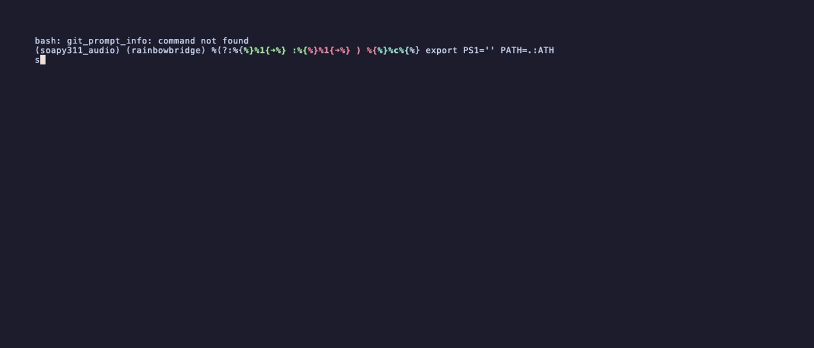
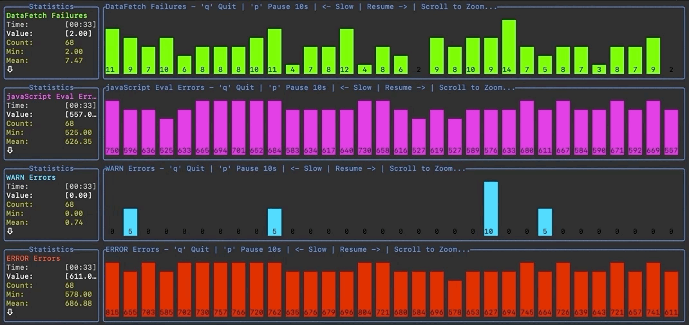
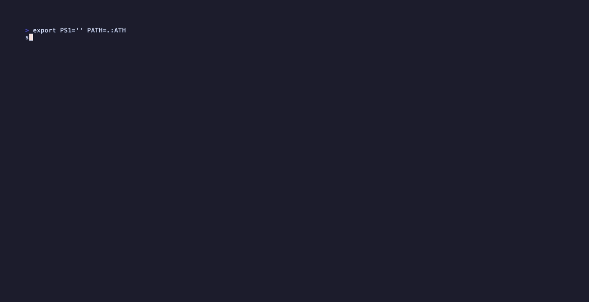

# DataDash

[](https://github.com/keithknott26/datadash/actions/workflows/ci.yml)
[](https://github.com/keithknott26/datadash/releases/latest)
[](https://goreportcard.com/report/github.com/keithknott26/datadash)
[](LICENSE)

> A high-fidelity, interactive data visualization tool for your terminal.

DataDash turns streams or files of numbers into beautiful, interactive charts — no GUI, no browser, no cloud. Pipe in CSV, TSV, JSON, or hit an HTTP endpoint, and watch your data come to life with sub-cell braille resolution, per-series panels, live statistics, and full keyboard navigation.


---

## ✨ What's New in v0.5

| Feature | What it does |
| --- | --- |
| 🎯 **Built-in demo mode** | `datadash demo` — see what the tool does in 5 seconds, no data required |
| 🔍 **Auto-detection** | CSV, TSV, JSON, NDJSON, pipe-, and space-delimited input — sniffed from the first line |
| 🌐 **HTTP polling** | `--url` flag turns any JSON endpoint into a live data source |
| 📡 **JSON / NDJSON** | Dot-path field extraction (`--field metrics.cpu`) with auto-discovery |
| 📐 **LTTB downsampling** | Same algorithm Grafana uses — preserves spikes and valleys when fitting a million points to your screen |
| 📊 **Per-series stats** | Min, Max, Mean, StdDev, P50, P95, P99 — aligned per row, updated live |
| 🎨 **Three chart types** | `--chart line` (default), `--chart bar`, `--chart sparkline` |
| ⌨️ **Keyboard navigation** | `h/l` pan, `+/-` zoom, `r` reset, `?` help, `q` quit |
| ✂️ **Smart parsing** | Currency symbols, percent signs, and thousands separators stripped automatically |
| 🛡️ **Robust errors** | Graceful handling of malformed input — no more panics on bad data |
| 🚀 **Cross-platform releases** | Pre-built binaries for Linux/macOS/Windows × amd64/arm64 |

---

## Quick Start

```bash
# From source
go install github.com/keithknott26/datadash/cmd@latest

# Or download a binary from Releases:
# https://github.com/keithknott26/datadash/releases/latest

# Try it — no data needed
datadash demo
```

---

## Installation

### Pre-built binaries

Download from [Releases](https://github.com/keithknott26/datadash/releases/latest) — Linux, macOS, and Windows binaries for amd64 and arm64 are attached to every release.

### Homebrew

```bash
brew install keithknott26/tap/datadash
```

### From source

```bash
git clone https://github.com/keithknott26/datadash.git
cd datadash
go build -o datadash ./cmd
./datadash demo
```

---

## Chart Types

DataDash supports three chart types via `--chart` (or `-c`):

| Type | Best for | Pan/Zoom | Notes |
| --- | --- | --- | --- |
| `line` (default) | Continuous time series, trends | ✓ | Sub-cell braille resolution, optional rolling average |
| `bar` | Recent values at a glance | — | Shows the last 30 values as proportional bars |
| `sparkline` | Compact dashboards, dense layouts | — | Tiny inline graphs with labels, accumulates over time |

---

## Demos

### Built-in demos

The fastest way to see DataDash in action — no input required.

```bash
datadash demo            # cycles through all generators (~30s each)
datadash demo metrics    # simulated server metrics (cpu, mem, rps, errors)
datadash demo sine       # multiple sine waves
datadash demo walk       # gaussian random walk (looks like a stock chart)
datadash demo anomaly    # baseline signal with random spikes
datadash demo pulse      # periodic pulses with exponential decay
```

Each demo also works with all chart types:

```bash
datadash demo metrics --chart bar
datadash demo metrics --chart sparkline
```

### Streaming data (line chart)

Scrolls right, keeping the most recent data visible:

```bash
seq 4000 | awk 'BEGIN{OFS="\t"; print "x"}{x=$1/10; print cos(x); system("sleep 0.01")}' \
  | datadash --label-mode time --scroll
```



### Streaming data (bar chart)

```bash
seq 4000 | awk 'BEGIN{OFS="\t"; print "x","sin(x)","cos(x)","rand(x)","rand(x)"}{x=$1/10; print x,sin(x),cos(x),rand(x),rand(x); system("sleep 0.02")}' \
  | datadash --chart bar
```



### Streaming data (sparklines)

```bash
seq 4000 | awk 'BEGIN{OFS="\t"; print "x","sin(x)","cos(x)","rand(x)","rand(x)"}{x=$1/10; print x,sin(x),cos(x),rand(x),rand(x); system("sleep 0.02")}' \
  | datadash --chart sparkline
```



### Tabular data with rolling average

```bash
seq 4000 | awk 'BEGIN{OFS="\t"; print "x","sin(x)","cos(x)","rand(x)","rand(x)","rand(x)"}{x=$1/10; print x,sin(x),cos(x),rand(x),rand(x),rand(x); system("sleep 0.02")}' \
  | datadash -a
```


### JSON / NDJSON streams

Auto-discovery of numeric fields:

```bash
echo '{"cpu":45.2,"mem":72.1}
{"cpu":51.8,"mem":68.4}
{"cpu":39.1,"mem":75.0}' | datadash
```

Explicit field extraction with dot paths:

```bash
echo '{"host":"web1","metrics":{"cpu":45.2,"mem":72.1}}
{"host":"web1","metrics":{"cpu":51.8,"mem":68.4}}' \
  | datadash -f json --field metrics.cpu --field metrics.mem
```

### HTTP polling

Watch live crypto prices:

```bash
datadash \
  --url 'https://api.coingecko.com/api/v3/simple/price?ids=bitcoin,ethereum,solana&vs_currencies=usd' \
  --field bitcoin.usd \
  --field ethereum.usd \
  --field solana.usd \
  --poll 30s
```

Watch weather data:

```bash
datadash \
  --url 'https://api.open-meteo.com/v1/forecast?latitude=37.77&longitude=-122.42&current=temperature_2m,wind_speed_10m,relative_humidity_2m' \
  --field current.temperature_2m \
  --field current.wind_speed_10m \
  --poll 60s
```

With authentication:

```bash
datadash \
  --url https://api.example.com/metrics \
  --header "Authorization: Bearer $TOKEN" \
  --field requests.rate --field errors.rate \
  --poll 5s
```

---

## Input Methods

DataDash accepts data from four sources, in priority order:

1. **`datadash demo`** — built-in synthetic data
2. **`--url <endpoint>`** — HTTP polling
3. **File argument** — `datadash data.txt`
4. **Stdin** — `cat data.txt | datadash`

---

## Data Format

DataDash auto-detects the format from the first line — TSV, CSV, pipe-delimited, JSON, NDJSON, whitespace, or single-column. Header rows are auto-detected and used as series names. Force a format with `-f`.

### Single column (1 graph)

```
50
60
70
```

### Multi-column (first column as label)

```
time	RowLabel1	RowLabel2
00:00	50	100
00:01	60	90
00:02	70	80
```

### JSON / NDJSON

```jsonl
{"cpu": 45.2, "mem": 72.1, "errors": 0}
{"cpu": 51.8, "mem": 68.4, "errors": 2}
```

### Decorated values

Currency symbols, percent signs, and thousands separators are stripped automatically:

```
$1,234.56	99%	€42.00
```

becomes `1234.56`, `99`, `42`.

---

## ⌨️ Keyboard Controls

| Key | Action |
| --- | --- |
| `h`, `←` | Pan left |
| `l`, `→` | Pan right |
| `+`, `=` | Zoom in |
| `-` | Zoom out |
| `r` | Reset view |
| `?` | Toggle help overlay |
| `q`, `Esc` | Quit |

---

## CLI Reference

```
Usage:
  datadash [file] [flags]
  datadash [command]

Available Commands:
  demo        Run a built-in demo dataset
  completion  Generate shell completions
  help        Help about any command

Flags:
  -d, --delimiter string         Column delimiter (auto-detected if omitted)
  -f, --format string            Input format: auto, csv, tsv, json, space, single (default "auto")
  -m, --label-mode string        X-axis label source: first, time, none (default "first")
      --field strings            JSON field to extract (dot path, repeatable)

  -c, --chart string             Chart type: line, bar, sparkline (default "line")
      --downsample string        Downsampling: lttb, minmax, none (default "lttb")
      --high-fidelity            Maximize braille sub-cell resolution (default true)

  -s, --scroll                   Scroll mode — keep newest data on screen
  -a, --average-line             Show a rolling average overlay (line chart only)
  -z, --average-seek int         Rolling average window size (default 500)
  -r, --redraw-interval duration Screen redraw interval (default 100ms)
  -l, --seek-interval duration   Input line read interval (default 20ms)

      --url string               Poll an HTTP endpoint instead of reading stdin/file
      --poll duration            HTTP poll interval (default 5s)
      --header strings           HTTP header, 'Key: Value' (repeatable)

      --debug                    Enable debug logging to stderr
  -v, --version                  Print version and exit
```

### Shell completions

```bash
# Bash
datadash completion bash | sudo tee /etc/bash_completion.d/datadash

# Zsh
datadash completion zsh > "${fpath[1]}/_datadash"

# Fish
datadash completion fish > ~/.config/fish/completions/datadash.fish
```

---

## Why DataDash Looks Sharp

**Braille canvas.** termdash renders lines using Unicode braille characters, giving 2×4 sub-pixel resolution per character cell. A 200×40 terminal effectively has a 400×160 drawing surface.

**LTTB downsampling.** When you have 100,000 data points and only 200 cells of space, DataDash uses the [Largest Triangle Three Buckets](https://skemman.is/handle/1946/15343) algorithm — the same one Grafana and Plotly use — to pick the points that preserve the curve's visual character.

---

## Architecture

```
datadash/
├── ring.go           # atomic ring buffer with stats + percentiles
├── row.go            # input parsing & format auto-detection
├── uniq.go           # generic deduplication
├── downsample.go     # LTTB & MinMax decimation
├── http_source.go    # HTTP polling reader
├── cmd/
│   ├── datadash.go   # main app: layout, keybinds, refresh loop
│   └── demo.go       # demo subcommand & data generators
└── tools/sampledata/ # bundled sample datasets
```

The library code is consumable as a Go package:

```go
import "github.com/keithknott26/datadash"

ring := datadash.NewRing(10000)
ring.Push(42.5)
stats := ring.Stats()
sampled := datadash.LTTB(rawData, 1000)
```

---

## Testing

```bash
go test -v -race -coverprofile=coverage.out ./...
go tool cover -html=coverage.out
go test -bench=. -benchmem ./...
```

---

## Similar Projects

- [termeter](https://github.com/atsaki/termeter) — the original inspiration
- [ttyplot](https://github.com/tenox7/ttyplot) — minimal real-time terminal plotting
- [asciigraph](https://github.com/guptarohit/asciigraph) — ASCII charts as a library
- [grafterm](https://github.com/slok/grafterm) — terminal-based Grafana

## Acknowledgments

Built on [termdash](https://github.com/mum4k/termdash). CLI powered by [cobra](https://github.com/spf13/cobra).

## License

MIT — see [LICENSE](LICENSE).